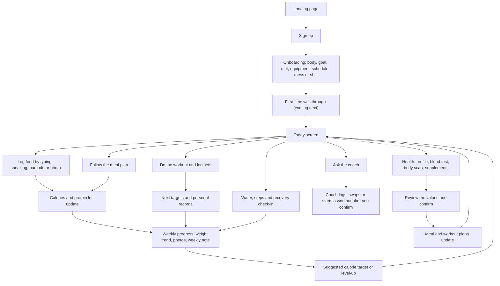

# RepEat AI

**A fitness and nutrition coach built for how India eats, trains and works.**

Most calorie apps are built around Western food and barcodes. Indian meals are home-cooked, mixed, and described in a mix of English and Hindi, and most people trying to get fit are also juggling an office day, a college timetable or a hostel mess. RepEat lets you log food the way you'd tell a friend about it, then turns that into accurate nutrition, personal targets, a meal plan and a workout plan that fit around your day.

  
  
  
  
  
  
  
  

- **Live app:** https://fitmind-ai-lyart.vercel.app
- **API docs:** https://fitmind-backend-vr5y.onrender.com/docs

> The backend runs on a free tier and sleeps when idle, so the first request can take up to a minute.

---

## What you can do today

### See your whole day on one screen

Open the app and Today shows what matters right now: your next meal with a one-tap "I ate this", how much of your calories and protein is left, today's workout, water, and a quick check on how rested you feel. Miss a couple of days and it offers an easy restart, not a guilt trip. The app installs on your phone's home screen and reminds you at your own meal and workout times.

### Log a whole day in one sentence

Type or speak something like *"subah 2 idli aur chai, dopahar ko dal chawal, raat ko khichdi"*. RepEat splits it into meals, works out the portions, and shows calories, protein, carbs and fat for each one. English, Hindi and Hinglish all work. You can also scan a packet's barcode or take a photo of your plate.

### Nutrition numbers you can trust

The numbers come from proper food databases first: INDB for Indian dishes, USDA for everyday staples and Open Food Facts for packaged food. Common street food and snacks (samosa, kachori, kadhi, pani puri, vada pav, momos and more) are built from standard piece weights, so they don't depend on a guess. The AI only fills in when a food isn't known at all; those numbers are marked as estimates with a likely range, and the app asks you to check one that looks much higher than a similar food or a portion bigger than usual. A plate of rajma chawal counts as one plate, not a plate of each. Every item shows where its numbers came from, and you can fix anything before saving.

### A meal plan that looks like home food

Your daily plan is made of real Indian dishes that fit your targets, diet (veg, eggetarian, non-veg, Jain), allergies, dislikes and budget. Swap any dish, ask for something different, or log a meal straight from the plan. Training in the morning? The day starts with water and a light pre-workout snack and ends with a wind-down before sleep. Rest days drop the pre-workout snack.

- **Grocery list:** the week's shopping, built from your plan and grouped by section of the shop.
- **Fasting and festival modes:** Navratri, Ramadan (sehri and iftar), Ekadashi and Jain Paryushan, each with the right food rules and meal times.
- **Night and rotating shifts:** meal times follow your shift, not a 9 to 5.
- **Healthy treat meals:** craving something sweet, a cake, pizza, a burger, tikka or street food? Pick it and get lighter versions like a chocolate protein mug cake, a grilled chicken burger or a paneer roti pizza. Each one fits your diet, allergies and health profile, and once you log it the rest of the day makes room. Two a week is the suggestion.

### PG and hostel mess mode

Nobody knows what the mess will cook tomorrow, but there is always roti and some sabzi or dal. Tell RepEat which meals the mess serves and what you keep on your shelf (milk, eggs, roasted chana, peanuts, bread). It tells you how many roti to take, fills the gaps with your shelf food, and shows what the extras cost. Short on protein? It names the cheapest fix.

### Workouts that pick the best exercise for you

Weekly plans follow ACSM and WHO guidelines for sets, reps and rest, and fit your equipment (full gym, dumbbells or nothing at home), your level, any injuries and how recovered you are. Every training day starts with a proper warm-up.

Every exercise in the library is ranked S, A or B by how well it works for its muscle, and plans always pick the best one you can actually do. A beginner at home gets pike push-ups and backpack squats; someone in a full gym gets hack squats and incline curls. You can filter the library by tier and by the muscle an exercise mainly trains. Every exercise has photos, a body map of the muscles it works, setup, form tips and common mistakes.

The plan grows with you. Log your weight and reps and each exercise tells you what to aim for next time: more reps first, then a bit more weight, or a harder version for bodyweight moves. New personal records are celebrated, an easy week is suggested when you stop progressing, and when you're ready the app offers to move you up from beginner to intermediate to advanced. Short on time? A 10, 15 or 20 minute session fits the day.

### Built for desk jobs

Log your daily steps and the app adjusts how active it thinks you are. Short routines for the neck, back, hips and wrists, plus gentle break reminders during work hours, help undo long hours of sitting.

### A private health profile

With your clear permission, you can add conditions like diabetes, thyroid or blood pressure, and the plans become safer for you. You only see options that apply to you, so pregnancy or PCOS never show up for men. All health data is encrypted and deleted along with your account.

### Upload your blood test

Upload a PDF or photo of any lab report: full body checkup, lipid profile, thyroid, HbA1c, vitamin D, B12. RepEat reads the values, you check each one before it's saved, and you can see how they change over time with plain-language explanations. Your meal plan and supplement suggestions take them into account. It never gives a diagnosis.

### Upload your body composition scan

Got an InBody (or similar) scan at the gym? Upload it and RepEat reads your weight, muscle, body fat, visceral fat and the muscle in each arm, leg and your trunk. If one side or one area is behind, the workout plan adds exercises for exactly that, and a weaker arm or leg is trained one side at a time. Your calorie targets use your lean mass, and if the scan doesn't match your goal (trying to bulk with high body fat, say), the app suggests a better goal. You decide.

### Supplements, only what you need

Tell RepEat what you can spend a month and it suggests the bare minimum for your body, diet and training, food first, no brands, nothing to sell. Track what you take, and your meal plan makes room for it at the right time of day. Steroids, hormones, SARMs, fat burners and weight-loss drugs are never listed or tracked.

### Progress you can actually see

A smoothed weight trend that ignores daily water swings, waist and hip measurements, and private progress photos. After a few weeks, RepEat compares what you ate with how your weight moved and suggests a better calorie target, which you can accept or ignore. It points out habits worth a look, writes a short note each week, and lets you mark weddings, festivals or trips as flexible days. Friend challenges and a shareable weekly summary keep it social.

### A coach that can take action

The chat coach sees your plan, targets, workouts and recovery. Ask it to log a meal, add water, swap a dish or start a quick workout, and it shows exactly what will change before anything happens. Paste a restaurant menu and ask "what should I order?" to get the best picks for what's left of your day.

---

## Coming next

These are planned and not built yet.

- **A first-time walkthrough.** Right after sign-up, a short guided tour that shows what each part of the app does and what to do first, second and third: log food, follow the meal plan, do the workout, talk to the coach, set up supplements. A new user should never feel lost.
- **Simple recipes on request.** Ask how to cook anything, from dal or pulao to roasted paneer or a treat meal, and get the simplest recipe for your portion, with amounts in grams, katori and spoons, and little oil.
- **Food that fits your region and season.** The plan will prefer vegetables and fruits that are actually in season where you live. In a Kashmir winter that means haak, nadru and turnip, not bhindi. Staples like dal, potato and onion stay available all year. In summer the focus is on water and chaach; in winter, warm food and soups. Following "thandi/garam taseer" will be an option you can switch on.
- **Vitamins and minerals.** See more than calories and protein: iron, calcium, magnesium, zinc, B12, vitamins A, C and D, both for each food and as a daily total against your targets.
- **Demo readiness.** End-to-end tests for the main journeys, demo data and error monitoring.

## Later

- Full data privacy compliance (DPDP) before opening to the public.
- A paid AI tier that doesn't train on health data.
- Family-style plans and real food prices, so your budget becomes a real limit.

---

## How a user moves through the app

In words: you sign up, answer a few questions about yourself, get a short tour, and land on Today. Every day you log food, follow the meal plan, train and check in. Every week the app looks at what happened and suggests small changes. Whenever you add health details, a blood test or a body scan, the plans update to match.

---

## Under the hood

| Layer | Stack |
|---|---|
| Frontend | React 19, TypeScript, Vite, MUI, TanStack Query, Zustand, installable PWA with Web Push |
| Backend | FastAPI, Python 3.12, MongoDB, WebSockets, APScheduler |
| AI | Gemini and Groq (Whisper for speech), with validated structured output, rule-based fallbacks, caching and per-user limits |
| Data | INDB, USDA FoodData Central, Open Food Facts, free-exercise-db, Wikimedia Commons |
| Infrastructure | Docker, Render, Vercel, MongoDB Atlas, Cloudflare R2 |

Designed and built end to end by **Dhruv Sharma**: product, backend, frontend, AI integration and deployment.

## License

MIT, see [LICENSE](LICENSE).
